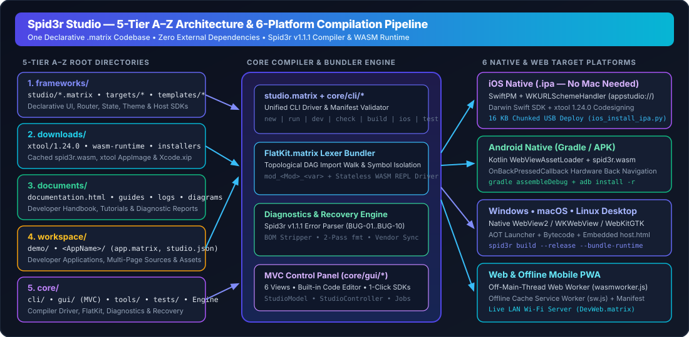
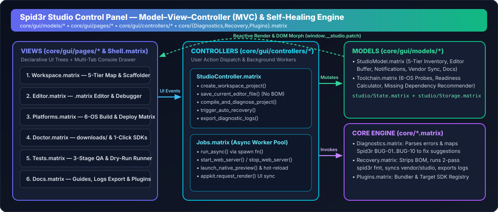

# Spid3r Studio (AppStudio)

**One `.matrix` / `.mt` Codebase. Six Native & Web Platforms. Zero Runtime Dependencies for Built Apps.**

**Spid3r Studio (v1.5.0)** is a cross-platform declarative UI framework, scope-aware bundler (`FlatKit`), CLI driver, and **MVC Desktop Control Panel** built natively in [Spid3r v1.5.0](https://github.com/needyamin/spid3r). Build, preview, and package applications for **Web / Mobile PWA**, **Windows**, **macOS**, **Linux**, **Android**, and **iOS** from a single `.matrix` / `.mt` codebase — including building, signing, and USB-installing iOS `.ipa` packages on physical iPhones without a Mac via `xtool`.


---

## Platform Capability Matrix

| Capability | Web / PWA | Android | iOS | Desktop (Win / macOS / Linux) |
| :--- | :---: | :---: | :---: | :---: |
| Declarative UI, theming, i18n/RTL & keyed DOM morph | Yes | Yes | Yes | Yes |
| Offline launch | Service Worker | Bundled | Bundled | Standalone binary |
| Hardware back navigation | History / `__studioBack` | Yes (`OnBackPressedCallback`) | Native bridge | Native window |
| Persistent local storage | IndexedDB + `localStorage` | WebView private storage | Application Support durable store | Atomic JSON (`write_file_atomic`) |
| Encrypted secret storage | WebCrypto AES-GCM | AndroidKeyStore AES-GCM | iOS Keychain | Host/App storage |
| Deep links & OAuth callback bridge | URL / `dispatchDeepLink` | Intent filter + `MainActivity` | URL schemes + `App.swift` | Window lifecycle + deep link |
| Native host effects (clipboard, share, files, geo, bio, camera, push, BLE) | Web APIs / Bridge | `StudioAndroid` bridge | `StudioNativeBridge` | WebView2 / WKWebView / WebKitGTK |
| Release packaging & CycloneDX 1.5 SBOM (`--release`) | CSP + SRI + `sbom.json` | Gradle R8 + signing + `sbom.json` | SwiftPM + `xtool` + `sbom.json` | Self-contained + MSIX/DMG/desktop + `sbom.json` |

*Web/Android/iOS bundles ship flattened `.matrix` source evaluated inside a persistent `spid3r.wasm` session; a build-time secret scanner (`BuildWeb.scan_secrets`) and `spid3r check --deny-warnings` gate run automatically on every build. Never embed server secrets in client bundles.*

---

## Why Spid3r Studio?

- **Full Spid3r v1.5.0 Compatibility:** Supports first-class `enum` + exhaustive `match`, `interface` / `implements`, named imports (`import { a, b as c } from "..."`), `.matrix` & `.mt` sources, destructuring `let (a, b) = ...`, 26 embedded stdlib modules (`semver`, `uuid`, `tz`, `toml`, `yaml`, `xml`, etc.) across both native and `spid3r.wasm`, and v1.5.0 desktop window lifecycle APIs (`gui_size`, `gui_min_size`, `gui_theme`, `gui_bg_color`, `gui_icon`, `gui_devtools`, `resize`/`focus`/`theme_changed`/`file_drop`/`before_close`).
- **True 6-OS Reach:** Compile standalone desktop executables (Windows, macOS, Linux), offline-ready WebAssembly Worker PWAs with CSP nonces and SRI, Android Gradle/Kotlin projects, and iOS SwiftPM `.ipa` packages from one `app.matrix`.
- **Full MVC Desktop Control Panel:** Manage projects visually — project scaffolding, `.matrix` source editor, compiler diagnostics, 1-click recovery, toolchain downloads, and real-device deployment.
- **No-Mac iOS Deployment:** Integrated `xtool 1.24.0` + Darwin Swift SDK + chunked `16 KB` USB installer (`ios_install_ipa.py`) builds, signs, and deploys `.ipa` packages from Windows/WSL2 or Linux.
- **Clean 5-Tier A–Z Architecture:** Strictly organized into `frameworks/`, `downloads/`, `documents/`, `workspace/`, and `core/`.

---

## Prerequisites — Install Spid3r v1.5.0

**Spid3r Studio v1.5.0 targets Spid3r v1.5.0.** Install `spid3r` (alias `sp`) and ensure it is on your `PATH` before running any `spid3r run studio.matrix ...` command.

### Windows
- **Microsoft Store (recommended):** Install [Spid3r](https://apps.microsoft.com/detail/9NPH5XX0F6KF) (`9NPH5XX0F6KF`) for instant `spid3r`, `sp`, `yamc`, `yamcvm`, `spvm`, `spkg`, and `spid3r-control` commands on `PATH`.
- **Installer:** Download `Spid3r-Setup-<version>.exe` from the [Spid3r Releases](https://github.com/needyamin/spid3r/releases) page.

### Linux / macOS
```sh
curl -fsSL https://raw.githubusercontent.com/needyamin/spid3r/main/install.sh | sh
```
- **VS Code Extension:** Install [Spid3r Formatter (`ANSNEWTECH.spid3r-formatter`)](https://marketplace.visualstudio.com/items?itemName=ANSNEWTECH.spid3r-formatter) for `.matrix` / `.mt` syntax highlighting, LSP, and formatting.

### Verify Your Environment
Run from the repository root:
```powershell
spid3r run studio.matrix doctor
```

---

## 30-Second Quick Start

### 1. Launch the Visual Control Panel
Double-click **`AppStudio.bat`** on Windows, or run:
```powershell
spid3r run studio.matrix gui
```

### 2. Build, Preview & Test from the CLI
```powershell
spid3r run studio.matrix new MyApp workspace/MyApp           # Scaffold a new app in workspace/
spid3r run studio.matrix run workspace/demo                  # Native desktop WebView preview
spid3r run studio.matrix dev workspace/demo                  # Live hot-reload desktop window
spid3r run studio.matrix dev workspace/demo --target web     # Live-reload Web/PWA LAN server
spid3r run studio.matrix check workspace/demo                # Static compiler verification
spid3r run studio.matrix build workspace/demo --target web --release
spid3r run studio.matrix build workspace/demo --target desktop --release
spid3r run studio.matrix build workspace/demo --target android
spid3r run studio.matrix ios run workspace/demo              # Build, sign & USB-install .ipa
spid3r run studio.matrix test                                # fmt --check + --deny-warnings + 5 suites
node --test core/tests/client_js.test.mjs                    # ClientJS + wasmhost + spid3r.wasm suite
```

---

## 5-Tier Project Structure



```text
AppStudio/
├── studio.matrix         # Slim CLI router (gui, new, run, dev, check, build, ios, test, clean, upgrade, doctor)
├── AppStudio.bat         # Windows double-click Control Panel launcher
├── frameworks/           # Declarative UI framework (studio/), 6-OS SDK templates (targets/), starter templates
├── downloads/            # Managed toolchains (xtool 1.24.0), cached spid3r.wasm runtime & dependency catalog
├── documents/            # Developer Handbook (documentation.html), guides, tutorials, references, diagrams, logs
├── workspace/            # Developer workspace (workspace/demo showcase & your apps)
└── core/                 # MVC Control Panel (gui/), CLI driver (cli/), FlatKit bundler, Diagnostics, Recovery & tests/
```



---

## Documentation & Contributing

| Document | Audience & Purpose |
| :--- | :--- |
| **[Architecture Guide](ARCHITECTURE.md)** | System design, runtime execution models, FlatKit bundler, and security gates |
| **[Getting Started Guide](documents/guides/getting-started.md)** | Step-by-step onboarding for Desktop, Web/PWA, Android, and iOS |
| **[Development Workflow](documents/guides/development-workflow.md)** | Daily dev loop, hot-reload, debugging, testing pyramid, and release checklist |
| **[Spid3r v1.5.0 Tutorial](documents/tutorials/matrix-language-tutorial.md)** | Authoring `.matrix`/`.mt` apps with `enum`/`match`, `Store`, stdlib, and window hooks |
| **[Configuration Reference](documents/references/configuration-reference.md)** | Complete `studio.json` schema, CLI flags, and environment variables |
| **[Contributing Guide](CONTRIBUTING.md)** | Coding conventions, extension recipes, verification gates, and PR checklist |
| **[Developer Handbook (HTML)](documents/documentation.html)** | Standalone visual handbook (open in any browser or inside the Control Panel) |
| **[MIT License](LICENSE.md)** | Open-source license and third-party notices |
